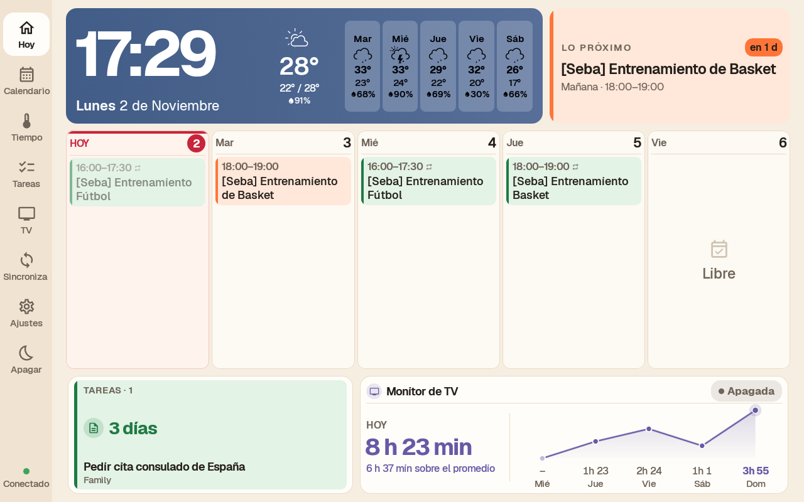

# Family Dashboard

Panel familiar Android **adaptado de [Planify Dashboard](https://github.com/eusonlito/Planify-Dashboard) para Amazon Fire**. La instalación de referencia es una Fire HD 8 de 7.ª generación, Fire OS basado en Android 5.1.1/API 22, en horizontal a 1280 × 800.

Conserva la base nativa Kotlin/Jetpack Compose, Open-Meteo, el calendario semanal, el reloj nocturno y la infraestructura de caché del proyecto original. Sustituye Planify-Backend por **Google Calendar y Google Tasks**, rediseña Inicio, Tareas y Ajustes e incorpora monitorización local de una TV Samsung. **No necesita Planify-APP ni Planify-Backend.**

## Funciones actuales

- **Inicio:** hora, fecha y clima; fondo celeste matinal que oscurece según la hora local; siguiente actividad; agenda de hoy y cuatro días más; próximas tareas y resumen de TV.
- **Calendario:** dos semanas navegables, eventos y ocurrencias recurrentes de Google Calendar, con previsión meteorológica.
- **Tiempo:** previsión por horas y hasta 14 días, gráficos de temperatura y lluvia e iconos Meteocons.
- **Tareas:** resumen, línea temporal de 14 días, vistas por fecha/lista, filtros y detalles expandibles.
- **TV:** sondeo de la API local Samsung/Tizen, sesiones, uso horario, mapa de calor y comparaciones por periodo.
- **Ajustes:** calendarios y listas visibles, horario con reloj de 12 horas y AM/PM, brillo, ubicación meteorológica, frecuencias de actualización, prueba de conexión de TV y cuenta Google.
- **Reloj nocturno:** hora, fecha y clima sobre negro, con brillo mínimo. Tocar permite consultar el panel temporalmente.

Google se consulta con permisos de **solo lectura**: no se crean, editan ni completan eventos o tareas. La interfaz táctil permite navegar, filtrar y configurar; la agenda de Inicio no edita datos. La acción «Configurar TV» abre Ajustes.



## Para agentes: empieza aquí

Esta sección está inspirada en la [guía para agentes de Planify Dashboard](https://github.com/eusonlito/Planify-Dashboard#para-agentes-empieza-aquí), pero corresponde a **Family Dashboard en Amazon Fire**. No apliques instrucciones del marco original: esta adaptación no necesita su backend, root, flasheo, cambios de particiones ni sus antiguos instaladores.

### Modelo de implementación: SDD

El proyecto sigue **SDD (Spec-Driven Development, desarrollo guiado por especificaciones)**: la especificación guía la implementación, no se escribe después para justificar el código. Tanto las funcionalidades nuevas como las adaptaciones de las existentes siguen este orden:

1. **Especificar:** definir alcance, requisitos y criterios de aceptación en `SPEC.md`; resolver dudas con la persona usuaria antes de implementar.
2. **Diseñar:** documentar componentes, decisiones, compatibilidad y riesgos en `DESIGN.md`.
3. **Planificar:** dividir el trabajo en tareas verificables en `TASKS.md`, vinculadas a requisitos y criterios de aceptación.
4. **Implementar:** desarrollar contra la especificación; si cambia el comportamiento acordado, actualizar primero los documentos afectados.
5. **Validar:** ejecutar las pruebas pertinentes, registrar evidencia y pendientes, y marcar como validado solo lo que se haya comprobado.

Consulta el [flujo SDD y sus plantillas](SPECS/README.md). La base vigente está en [SPECS/current-version/](SPECS/current-version/); los nuevos trabajos se documentan según ese flujo, sin duplicar ni contradecir los requisitos actuales.

### Antes de actuar

1. Lee las [reglas siguientes](#reglas-de-trabajo) y la [especificación vigente](SPECS/current-version/SPEC.md).
2. Consulta la [arquitectura](docs/ARCHITECTURE.md) y el [diseño vigente](SPECS/current-version/DESIGN.md) antes de cambiar código. Revisa `git status` para distinguir el trabajo previo de tus cambios.
3. Si vas a trabajar con una tablet, lee primero [Instalación en Amazon Fire](docs/SETUP.md); para autenticación, consulta [Google/OAuth](GOOGLE_CLOUD_SETUP.md).
4. Comprueba el dispositivo con comandos de solo lectura. La referencia es **Fire HD 8 de 7.ª generación, modelo KFDOWI, API 22 y 1280 × 800**; no presupongas que otra Fire se comporta igual.

   ```sh
   adb devices -l
   adb -s <identificador> shell getprop ro.product.model
   adb -s <identificador> shell getprop ro.build.version.sdk
   adb -s <identificador> shell wm size
   ```

   La resolución puede aparecer con los ejes invertidos según la orientación. Si el modelo, la API o las medidas no coinciden, detente y consulta antes de instalar o adaptar nada.

### Reglas de trabajo

1. **Pregunta ante cualquier duda.** No elijas por tu cuenta qué eliminar, cambiar de comportamiento o sustituir. Explica el alcance y pide confirmación si no está claro.
2. **Leer no autoriza a escribir en la tablet.** Instalar, cambiar ajustes del sistema, permisos, cuentas, Device Owner o autorización Google requiere permiso explícito para esa acción. Una autorización anterior no se extiende automáticamente a otras operaciones.
3. **Protege la identidad de instalación.** No cambies `applicationId`, namespace, certificado, almacén de claves ni credenciales OAuth. Family Dashboard es el nombre visible; `com.lito.planify.dashboard` sigue siendo el paquete técnico.
4. **No borres datos para resolver un problema.** No desinstales, ejecutes `pm clear`, cierres sesión ni retires cuentas sin autorización específica. Ante un conflicto de firmas, detente y revisa el APK; no fuerces una reinstalación destructiva. Antes de una operación con riesgo, acuerda cómo conservar los datos y recuperarse.
5. **Conserva lo que aún se usa.** Comprueba llamadas, pruebas, referencias indirectas y compatibilidad de datos antes de retirar código. Que Google no rellene un campo o que una función no se vea en Inicio no demuestra que sobre. No renombres claves ni elimines campos persistidos sin revisar migración y recuperación.
6. **Respeta el trabajo existente.** No reviertas cambios ajenos ni uses resets destructivos. Haz cambios acotados, explica su verificación y no hagas commit ni push salvo petición expresa.
7. **Los datos de diagnóstico son privados.** Tokens, claves, cuentas, IP, SSID, números de serie, volcados y capturas con datos familiares no deben publicarse. Mantén secretos fuera del repositorio y revisa cualquier captura o log antes de incorporarlo a documentación.
8. **Valida en la Fire, sin alterar su configuración innecesariamente.** El emulador no confirma el comportamiento de Fire OS, Play Services, táctil o suspensión. No cambies el reloj ni datos reales para simular escenarios si puedes probar funciones puras o usar datos temporales; retíralos antes de la build final. Pantalla completa no equivale a Device Owner.
9. **Documenta lo vigente y lo comprobado.** Sigue el [flujo de especificaciones](SPECS/README.md), actualiza requisitos/diseño/tareas cuando cambie el comportamiento y registra resultados en [Validación](SPECS/current-version/TASKS.md). Distingue evidencia, supuestos y pendientes; conserva los créditos y licencias de Planify y terceros.

### Verificación y entrega

- Ejecuta las [pruebas y compilación pertinentes](#compilar-y-actualizar); informa exactamente qué comprobaste y qué quedó pendiente.
- Antes de una actualización autorizada, verifica nombre, paquete y certificado del APK contra la instalación existente. Usa `adb install -r` con la misma firma, sin desinstalar.
- Tras actualizar, comprueba que siguen la cuenta, las selecciones, los ajustes y el historial TV. No cierres sesión ni cambies controles solo para completar una comprobación sin permiso.
- La publicación del sitio y los cambios de Google Cloud, DNS o Branding son operaciones externas separadas: modificar archivos locales no las realiza ni las autoriza.

## Compilar y actualizar

Requiere JDK 17 o superior, Android SDK con plataforma 37 y Google Play Services operativo en la Fire para autorizar Calendar/Tasks.

```sh
cd android
ANDROID_HOME="$HOME/Library/Android/sdk" ./gradlew :app:testDebugUnitTest :app:assembleRelease
adb install -r app/build/outputs/apk/release/app-release.apk
```

La release utiliza la firma de producción existente, configurada fuera del repositorio. **No cambiar la firma ni el paquete `com.lito.planify.dashboard`**: son parte de la identidad de instalación y de la autorización OAuth. No instalar una APK debug encima de producción ni desinstalar para resolver un conflicto de firmas: se perderían datos locales.

Consulta [Instalación en Amazon Fire](docs/SETUP.md) antes de instalar y [Google/OAuth](GOOGLE_CLOUD_SETUP.md) antes de configurar credenciales.

## Documentación

| Documento | Contenido |
|---|---|
| [Instalación](docs/SETUP.md) | Requisitos, actualización sin perder datos, ajustes y límites de Fire OS |
| [Arquitectura](docs/ARCHITECTURE.md) | Componentes activos, datos, persistencia y pruebas |
| [Google/OAuth](GOOGLE_CLOUD_SETUP.md) | Permisos reales, identidad Android y configuración externa |
| [Especificación vigente](SPECS/current-version/SPEC.md) | Comportamiento actual, sin diseños intermedios sustituidos |
| [Diseño vigente](SPECS/current-version/DESIGN.md) | Decisiones e invariantes de compatibilidad |
| [Validación](SPECS/current-version/TASKS.md) | Evidencia y verificaciones pendientes |

## Límites importantes

- La referencia probada es la Fire HD 8 indicada; no se garantiza compatibilidad con todos los modelos Amazon Fire.
- La instalación de referencia usa pantalla completa, **no Device Owner**. El código opcional de quiosco se conserva, pero no implica que el bloqueo estricto esté activado.
- El sondeo de TV funciona mientras la app está activa. Una falta de respuesta se registra como apagado **inferido**, no como confirmación física.
- El historial TV se calcula en `America/Asuncion`. Calendario y fondo horario usan la hora local del dispositivo.
- La caché conserva la última descarga; no equivale a disponer de Google sin autorización. Un arranque sin token puede requerir recuperar la autorización con Play Services.
- La legibilidad a 2–3 m y el manejo de la esfera horaria con el dedo siguen pendientes de validación por la persona usuaria.

## Origen, licencias y créditos

Family Dashboard es una adaptación, no un reemplazo oficial de Planify ni una aplicación de Amazon. El código base procede de **[Planify Dashboard, de eusonlito](https://github.com/eusonlito/Planify-Dashboard)**, publicado bajo [MIT](LICENSE). Se conserva su aviso de copyright. El proyecto original reconoce la referencia de [wesbos/photo-frame-dashboard](https://github.com/wesbos/photo-frame-dashboard).

- Fuentes **Geist y Geist Mono**: [licencia OFL](licenses/Geist-OFL.txt). Ambas siguen en uso.
- Iconos meteorológicos **Meteocons**, de Bas Milius: [licencia y procedencia](third_party/meteocons/). El generador activo es `scripts/meteocons.py`.
- El icono heredado se conserva; el nombre visible es **Family Dashboard**. Los nombres internos de paquete, firma y credenciales no se renombran.
